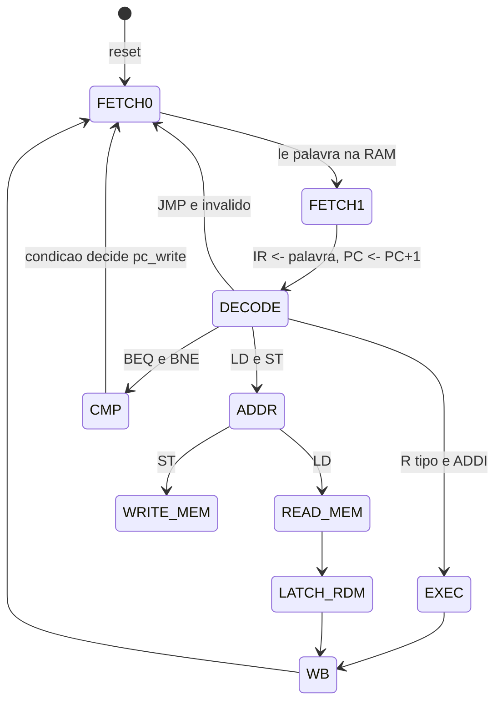

# Unidade de controle

O `control_unit.vhd` comanda o `datapath.vhd`. A traducao do opcode em
propriedades da instrucao esta em `decoder.vhd`; a maquina de estados fica no
`control_unit`. Entradas: `clk`, `reset`, `opcode` e `zero`. Saidas: os 14
sinais de controle do datapath mais `state_out`, com o estado codificado de 0
a 9.

## Estados



`FETCH0` habilita `mem_read` com endereco do PC. Como a RAM registra
`data_out`, a palavra so esta disponivel no ciclo seguinte, quando `FETCH1`
captura o IR e avanca o PC. O mesmo motivo explica `READ_MEM` e `LATCH_RDM`
serem estados separados.

## Sinais por estado

| Estado | Sinais em 1 | Proximo estado |
| --- | --- | --- |
| 0 FETCH0 | `mem_read` | FETCH1 |
| 1 FETCH1 | `ir_write`, `pc_write` (`pc_sel=00`) | DECODE |
| 2 DECODE | `reg_a_write`, `reg_b_write`, `read_addr2_sel`; se JMP: `pc_write` (`pc_sel=10`) | EXEC / ADDR / CMP / FETCH0 |
| 3 EXEC | `alu_out_write`, `alu_op`, `alu_b_sel` | WB |
| 4 ADDR | `alu_out_write`, `rem_write`, `alu_op=000`, `alu_b_sel=1` | READ_MEM / WRITE_MEM |
| 5 READ_MEM | `mem_read`, `mem_addr_sel=1` | LATCH_RDM |
| 6 LATCH_RDM | `rdm_write` | WB |
| 7 WRITE_MEM | `mem_write`, `mem_addr_sel=1` | FETCH0 |
| 8 CMP | `alu_op=001`, `alu_b_sel=0`; se condicao: `pc_write`, `pc_sel=01` | FETCH0 |
| 9 WB | `reg_write`, `wb_sel` | FETCH0 |

Todos os sinais nao listados ficam em zero. O `alu_op` so e habilitado em
EXEC, ADDR e CMP; `read_addr2_sel` em DECODE; `wb_sel` em WB. Isso evita
capturas indevidas em estados em que o sinal nao tem significado.

## Decoder

| Opcode | Instrucao | `alu_op` | `alu_b_sel` | `read_addr2_sel` | `wb_sel` | flag |
| --- | --- | --- | --- | --- | --- | --- |
| 0000 | ADD | 000 | 0 | 0 | 0 | |
| 0001 | SUB | 001 | 0 | 0 | 0 | |
| 0010 | AND | 010 | 0 | 0 | 0 | |
| 0011 | OR | 011 | 0 | 0 | 0 | |
| 0100 | SLT | 100 | 0 | 0 | 0 | |
| 0101 | ADDI | 000 | 1 | 1 | 0 | |
| 0110 | LD | 000 | 1 | 1 | 1 | `is_load` |
| 0111 | ST | 000 | 1 | 1 | 0 | `is_store` |
| 1000 | BEQ | 001 | 0 | 1 | 0 | `is_branch`, `branch_on_zero=1` |
| 1001 | BNE | 001 | 0 | 1 | 0 | `is_branch`, `branch_on_zero=0` |
| 1010 | JMP | 000 | 0 | 0 | 0 | `is_jump` |
| 1011-1111 | invalido | 000 | 0 | 0 | 0 | `is_invalid` |

## Saltos e casos especiais

- Em `CMP` a ULA continua calculando `Rj - Ri` com os operandos capturados em
  `DECODE`. O desvio e tomado quando `zero = branch_on_zero`: BEQ com Zero=1,
  BNE com Zero=0. O alvo e calculado no datapath como `PC + sext(imm)`, com o
  PC ja incrementado na busca.
- JMP carrega o PC ainda em `DECODE`, com `pc_sel=10` e o campo `end` da
  instrucao.
- Instrucao invalida e ignorada: em `DECODE` nenhum enable e ativado e a
  maquina volta a `FETCH0`. O PC ja avancou em `FETCH1`, entao a proxima
  palavra e executada normalmente.
- Reset assincrono ativo alto leva ao estado 0 com todos os controles zerados,
  exceto `mem_read` do propio `FETCH0`.

## Testes

```bash
GHDL=/caminho/para/ghdl bash tests/run_control_unit.sh
```

`tb_control_unit.vhd` dirige `opcode` e `zero` e confere `state_out` e os 14
sinais em cada estado. Cobre ADD/SUB/AND/OR/SLT, ADDI, LD, ST, BEQ e BNE
tomados e nao tomados, JMP, opcode invalido, reset no meio da sequencia e a
ausencia de `reg_write`/`mem_write` nos estados que nao escrevem.
