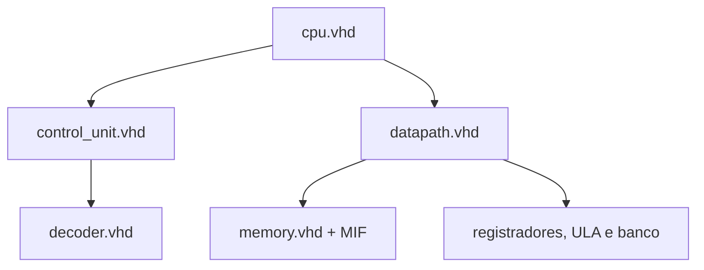

# CPU completa

`cpu.vhd` e o topo da hierarquia. Ele instancia o `control_unit` e o
`datapath`. A RAM esta dentro do datapath, entao nao aparece como entidade
separada no topo.



## Interfaces

### Entradas

| Porta | Largura | Funcao |
| --- | --- | --- |
| `clk` | 1 | Clock; todas as capturas na subida |
| `reset` | 1 | Assincrono ativo alto; zera registradores e PC |

### Generic

| Nome | Padrao | Funcao |
| --- | --- | --- |
| `init_file` | `cpu_test.mif` | Imagem da RAM, carregada na simulacao e no Quartus |

### Saidas de observacao

| Porta | Largura | Funcao |
| --- | --- | --- |
| `address_fault` | 1 | Falha de endereco retida ate reset; CPU parada |
| `pc` | 16 | Endereco atual do PC |
| `instruction` | 16 | Palavra no IR |
| `state` | 4 | Estado da FSM, codificado de 0 a 9 |
| `opcode` | 4 | Opcode da instrucao no IR |
| `zero`, `overflow` | 1 | Flags combinacionais da ULA |
| `a`, `b` | 16 | Operandos capturados em reg_a e reg_b |
| `alu_result` | 16 | Resultado capturado em alu_out |
| `rdm` | 16 | Dado capturado no registrador de dados da memoria |
| `fetched` | 16 | Ultima palavra entregue pela RAM |
| `reg_write`, `mem_write` | 1 | Habilitacoes de escrita no banco e na RAM |
| `reg_write_addr`, `reg_write_data` | 3 / 16 | Endereco e dado da ultima escrita no banco |
| `mem_addr`, `mem_write_data` | 10 / 16 | Endereco e dado da ultima escrita na RAM |

As portas de observacao nao alteram o funcionamento: elas apenas expoem sinais
internos para simulacao, LEDs e displays na FPGA.

## Arquivos necessarios

Compilar nesta ordem com GHDL:

```bash
ghdl -a --std=08 \
    pc.vhd instruction_register.vhd memory.vhd register_file.vhd \
    immediate_extender.vhd reg_a.vhd reg_b.vhd alu.vhd alu_out.vhd \
    memory_address_register.vhd memory_data_register.vhd \
    datapath.vhd decoder.vhd control_unit.vhd cpu.vhd
ghdl -e --std=08 cpu
```

Para simular, `cpu_test.mif` deve estar no diretorio de execucao. No Quartus,
os 15 fontes RTL da lista acima entram no projeto (excluir `tests/`) e `cpu_test.mif` (ou outro MIF passado no
generic) vincula a RAM inicial.

## Teste integrado

```bash
GHDL=/caminho/para/ghdl bash tests/run_cpu.sh
```

`tb_cpu.vhd` aplica reset, roda o programa de demonstracao de `docs/isa.md`
carregado em `cpu_test.mif` e observa as escritas pelas portas de depuracao.
O programa soma 1 tres vezes em R3, grava em Mem[16], rele em R4 e entra em
`JMP 9`. O teste executa duas vezes por reset e confere R3=R4=Mem[16]=0003,
exatamente uma escrita por execucao, instrucao inicial preservada e o loop final.

A sequencia completa de controle esta em [docs/control_unit.md](control_unit.md)
e as conexoes internas em [docs/datapath.md](datapath.md).

## Falha de endereco

O datapath bloqueia efeitos na borda que detecta um endereco invalido e
registra `address_fault`. Esse sinal entra em `halt` no controle, zerando
os enables e congelando a FSM. A deteccao usa o endereco completo do PC na
busca e a saida combinacional da ULA na captura do REM. O PC e os dados
ficam retidos ate reset; nao existe instrucao nova nem vetor de excecao.
A falha e registrada, evitando um laco combinacional controle/falha.

Ao integrar na placa, conectar `address_fault` a um LED de diagnostico.
A saida tem valor padrao para permitir omissao em instanciacoes antigas.
