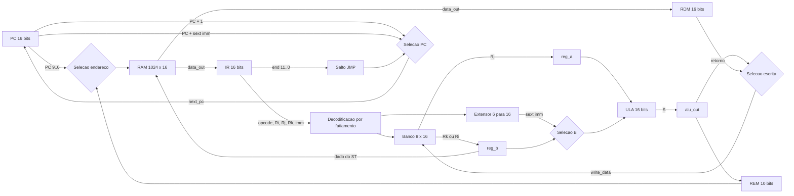

# Caminho de dados

O `datapath.vhd` liga todos os componentes existentes. Ele nao tem maquina de
estados: os sinais de controle entram pela porta e serao gerados pela unidade
de controle. As saidas `opcode`, `zero`, `overflow` e `fetched_word` devolvem
informacao para a controle.

## Conexoes



A RAM tem uma porta so. O endereco vem do PC na busca da instrucao e do REM
no acesso a dado. Por isso busca e leitura/escrita de dado nunca acontecem no
mesmo ciclo.

## Sinais de controle

| Sinal | Efeito |
| --- | --- |
| `pc_write` | Carrega `next_pc` no PC na subida |
| `ir_write` | Captura a palavra vinda da RAM no IR |
| `reg_write` | Escreve `write_data` em Ri no banco |
| `reg_a_write` / `reg_b_write` | Capturam Rj e Rk/Ri nos registradores da ULA |
| `alu_out_write` | Captura o resultado combinacional da ULA |
| `rem_write` | Captura os 10 bits baixos da saida da ULA no REM |
| `rdm_write` | Captura `data_out` da RAM no RDM |
| `mem_read` / `mem_write` | Leitura/escrita da RAM no endereco selecionado |
| `alu_op` | Seletor interno da ULA: 000 ADD, 001 SUB, 010 AND, 011 OR, 100 SLT |
| `read_addr2_sel` | 0 = le Rk (tipo R), 1 = le Ri (tipo I) |
| `alu_b_sel` | 0 = operando B vem de `reg_b`, 1 = vem do imediato estendido |
| `mem_addr_sel` | 0 = PC, 1 = REM |
| `pc_sel` | 00 = PC+1, 01 = PC + imediato (desvio), 10 = endereco de 12 bits (JMP) |
| `wb_sel` | 0 = resultado da ULA, 1 = dado do RDM |

## Flags

`Zero` e `Overflow` sao combinacionais e nao ficam armazenados. O BEQ/BNE
decide no mesmo ciclo em que a ULA compara Ri e Rj, usando `zero` e o `opcode`
da instrucao em execucao. A ISA nao usa `Overflow`, entao ele apenas fica
disponivel para observacao.

## Tempo de captura

A saida da RAM so e valida no ciclo seguinte ao da leitura. Por isso a busca
leva duas bordas: primeiro `mem_read=1` com endereco do PC, depois `ir_write=1`
e `pc_write=1`. O mesmo vale para o LD: REM na borda da execucao, leitura da
RAM, captura no RDM e so entao escrita no banco.

| Instrucao | Sequencia de bordas |
| --- | --- |
| Aritmetica | busca (2) -> A/B -> alu_out -> banco |
| LD | busca (2) -> A/B -> alu_out e REM -> RAM -> RDM -> banco |
| ST | busca (2) -> A/B -> alu_out e REM -> RAM |
| BEQ/BNE | busca (2) -> A/B -> comparacao e carga do PC |
| JMP | busca (2) -> carga do PC com `end` |
| Invalida | busca (2) -> sem escrita |

Na busca da instrucao invalida a controle deve manter `pc_write=0`: o campo
`fetched_word` ja contem a palavra lida e permite detectar o opcode
`1111` antes de avancar o PC.

## Testes

`tests/tb_datapath.vhd` dirige os controles borda a borda e verifica a busca,
a captura de operandos, o resultado da ULA, a ordem entre `alu_out` e REM, a
gravacao e a leitura da memoria, o retorno ao banco, o desvio tomado e nao
tomado, o JMP e o congelamento do PC em opcode invalido.

```bash
GHDL=/caminho/para/ghdl bash tests/run_datapath.sh
```
